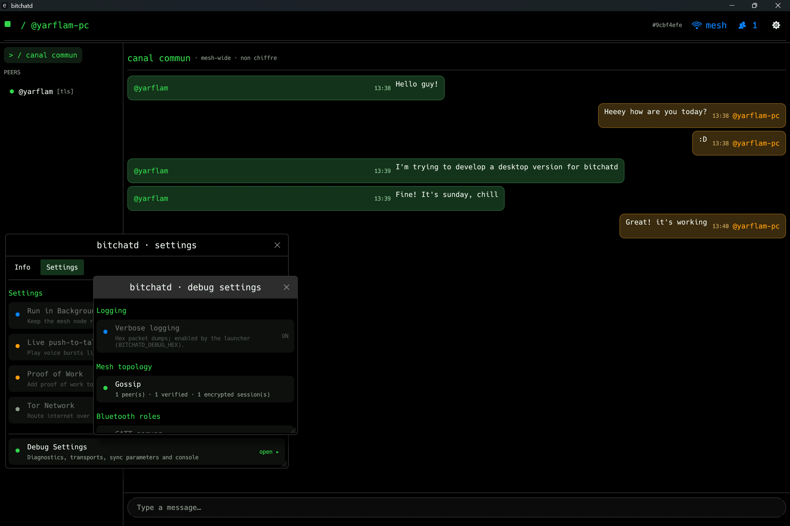

## bitchat for desktop (`bitchatd`)

A decentralized peer-to-peer messaging **node for Windows PCs**, speaking the
same wire protocol as the bitchat mobile mesh: join the Bluetooth mesh, chat
on the mesh-wide channel, and hold end-to-end encrypted private
conversations — no smartphone required. No accounts, no phone numbers, no
central servers.

The node is byte-compatible with the deployed bitchat protocol (announcements,
packet framing, Noise XX sessions, gossip sync), so phones on the mesh see it
as a regular peer.

[bitchat.free](http://bitchat.free)

## See it in action



## Features

- **Full mesh participation over BLE**: acts as GATT central *and* peripheral
  simultaneously — it auto-connects to discovered peers and accepts incoming
  connections from phones.
- **Mesh-wide broadcast channel**: send and receive unencrypted mesh
  broadcasts (`#` prefix in the console UI, or the common channel in the GUI).
- **End-to-end encrypted private chat**: [Noise Protocol](https://noiseprotocol.org)
  XX sessions (X25519 + ChaCha20-Poly1305) with automatic handshake
  initiation, plus an authenticated capabilities/state exchange (payload
  `0x21`) right after session establishment, mirroring the mobile client.
- **Gossip synchronization**: GCS-filtered sync offers and requests keep
  announcements and messages converged across the mesh.
- **Verified identity announcements**: Ed25519-signed announcements with
  peer IDs derived from Noise static keys; only verified packets are relayed.
- **Single-link preference**: when a peer connects inbound, the node drops
  its outgoing link to that peer — two GATT sessions over one ACL link
  churned both, so one link per peer wins.
- **Terminal-themed desktop GUI** (egui): peer list with status dots, common
  channel + private conversations, editable nickname, Settings (Info |
  Settings tabs) and Debug Settings windows mirroring the mobile app, and a
  composer that keeps keyboard focus after sending.
- **Manual Connect**: the debug window lists recent scan results with a
  Connect button that force-connects by MAC address — the same job as the
  debug Connect on mobile.
- **Persistent identity and config**: long-term keys in `bitchatd.identity`,
  all durable preferences in a single `bitchatd.toml` (nickname today,
  favorites and more tomorrow).
- **Optional desktop notifications**: toasts for incoming messages while the
  window is unfocused (opt-in via `BITCHATD_NOTIFY=1`).

## Quick start

Requires a Rust toolchain (2021 edition) on Windows 10/11 with Bluetooth LE.

```bash
cd desktop
cargo build -p bitchat-node --examples

# GUI node (recommended)
run_node_gui.cmd

# Console node
run_node.cmd
```

The node generates `bitchatd.identity` (private keys) and `bitchatd.toml`
(configuration) in the working directory on first run. Set
`BITCHATD_NICKNAME` to override the nickname for a single run.

For the best BLE experience, register the sparse package once (Developer Mode
required) so the process gets package identity — see
[Troubleshooting](#troubleshooting) for what degrades without it.

## Repository layout

```
desktop/
  crates/
    bitchat-wire/   protocol: packets, announcements, Noise payloads, GCS, padding
    bitchat-ble/    BLE central + peripheral (WinRT), framing, MTU handling
    bitchat-node/   session orchestration, gossip, routing, config, GUI/console examples
  sparse/           optional MSIX sparse package (package identity for BLE APIs)
  run_node_gui.cmd  launch the GUI node detached, logs to %TEMP%\bitchatd_gui.log
  run_node.cmd      launch the console node
```

Golden-vector tests pin the wire format against the mobile protocol:

```bash
cd desktop
cargo test
```

## Troubleshooting

Real-world BLE on Windows is… spiky. This is everything we hit running the
node against production phones — symptoms first.

### The node stops connecting / every connect times out (Windows)

The Windows BLE stack can wedge after long sessions or repeated failed
connect attempts: outgoing connects time out forever, even though the peer is
right there. The reliable un-wedge is an **incoming** connection — connect
once *to* the PC from the phone (or tap Connect on the PC from any BLE
scanner app like nRF Connect), or toggle the Bluetooth radio. Restarting the
node alone does not help; it is the adapter state that is stuck.

### The phone never auto-connects to the PC

By design, mostly. The mobile app suppresses its own outgoing connection
whenever *any* link already exists between the two devices (duplicate-
connection avoidance), and the node holds the outgoing link almost all the
time — so the phone's auto-connect rarely gets a chance. The desktop node's
debug window shows recent scan results with a **Connect** button that forces
an outgoing connection by MAC address; use it exactly like the debug Connect
on mobile. On the phone, the PC may show up as `unknown` in the *Connected
devices* debug list — that is a cosmetic limitation: client-role links only
display peer IDs learned from scan service data, while the app does learn
the identity from the announcement itself.

### Custom advertisement data (service data / peer ID in the advert)

Phones read the peer ID from service data in the advertisement. On Windows
this is only partially achievable:

- `BluetoothLEAdvertisementPublisher` requires **package identity**. The repo
  ships a sparse package (`desktop/sparse/`); with Developer Mode on,
  register it once with `Add-AppxPackage -Path ...\sparse\AppxManifest.xml
  -Register`. The node logs its package identity at startup.
- Even with identity, the payload cannot go on air: the UUID list plus
  service data is 44 bytes — over the 31-byte legacy advertising PDU — and
  the WinRT stack rejects UUID-list AD types in extended advertisements.
  `E_ACCESSDENIED (0x80070005)` from `publisher.Start()` is this size limit,
  not a permission problem.

So the node advertises the **service UUID only**, and phones learn the peer
ID from the announcement after connecting. The node detects the situation
and falls back automatically (watch for `custom advertisement unavailable …
advertising service UUID only` in the log); nothing needs to be done.

### The phone can't send right after connecting (first message lost)

The mobile client only starts its Noise handshake when the user sends a
message — and drops that first message. The node works around this by
initiating the handshake itself as soon as a peer's verified announcement
arrives over an inbound link, and by sending its authenticated state
(Noise payload `0x21`) immediately after session establishment, so either
side can talk first. If you run an older phone build that still eats the
first message, just send it twice.

### Weirdness in the packet capture

`BITCHATD_DEBUG_HEX=1` logs every frame in hex. Occasionally you will see a
peer ship encrypted traffic with keys from a previous session generation
right after a reconnect (the node counts decrypt failures and re-handshakes
after three), or frames that the phone seemingly ignores. Some of these
look like quirks of the deployed mobile client rather than this node; the
node is fail-closed — undecryptable traffic is dropped and triggers a fresh
handshake, never forwarded.

### Desktop notifications make typing impossible

Windows toast notifications steal OS focus. Even rate-limited, a toast fired
while you are typing eats your keystrokes. Notifications are therefore
**opt-in**: set `BITCHATD_NOTIFY=1` in the launcher script if you want them.

### Logs

The GUI launcher redirects stderr to `%TEMP%\bitchatd_gui.log`
(`C:\Users\<you>\AppData\Local\Temp\bitchatd_gui.log`). The console node logs
to its terminal.

## License

This project is released into the public domain. See the [LICENSE](LICENSE.md) file for details.
